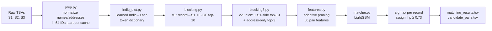

# Business Entity Resolution: TF-IDF blocking + LightGBM matcher

Solo entry to the **Amazon ML Challenge 2026** (72 hours, 25–27 Sep 2026).
Final public leaderboard: **0.9656 macro F0.5** (grouped holdout: 0.9740). The top-50 cutoff was 0.9852, so this did not place; see [Results](#results) and [Closing the gap](#what-id-do-to-close-the-gap-to-0985).

## The problem

Three sources describe the same businesses (name, address, country) with no shared keys. Source 1 is a clean reference list; Sources 2 and 3 are noisy copies with typos, abbreviations, reordered addresses, brand names, empty fields and Indic-script names, mixed with look-alike records that match nothing. For every Source 1 entity, the task is to return the Source 2/3 records that are the same business. Scoring is F0.5 per Source 1 entity, averaged over all of them, so a wrong merge costs about twice as much as a missed one. Training data covers the US and India; the test set adds France, which has no labels.

**The competition data is not included in this repository** (competition terms). The docs report only aggregate statistics.

## Approach



What the EDA found ([docs/EDA.md](docs/EDA.md)):

- **Each S2/S3 record belongs to at most one S1** (no exceptions in 7.6M training pairs), and about 26% of records match nothing. Treating it as an *assignment* problem (record → ≤1 S1), not a pairwise one, was a large precision gain.
- **Precision was mostly lost to synthetic distractors.** In the cosine-threshold baseline, 95% of false positives were near-duplicates of a real S1: the same name with an extra word or a swapped legal suffix, and a house number moved by a few digits. Cosine similarity can't separate them. Features describing *how* a record differs from its S1 can.
- **Recall was mostly lost in blocking.** The worst slices were Indic-script names, which share no character n-grams with the Latin S1, and records with empty addresses.
- **Country never differs within a match**, so all work is partitioned by the `country` string as an open set. Nothing is hard-coded per country, and the model has no country feature, because France only appears in test.

## Blocking

Per country, a TF-IDF space is fit **on S1 only**. It combines char 3-grams of the name core (legal suffixes removed) with word tokens of the address, each view L2-normalized, then stacked. Three retrievals are unioned:

| retrieval | why |
|---|---|
| record → S1 top-10 | the main view; Indic names are first rewritten with the learned dictionary |
| S1 → record top-10 | recovers records crowded out of their own top-10 by look-alike S1s |
| record → S1 address-only top-3 | brand names that share nothing with the S1 name |

All searches are two-stage: top-N on rare features only (document frequency ≤ 5000), then rescored with the full vectors. That brings an S1 query to about 1 ms. Index order is hash-permuted, so exact-cosine ties (31% of pairs) never depend on ID order. A leakage audit caught this; see [D-017](docs/DECISIONS.md).

**Indic names ([D-014](docs/DECISIONS.md)).** About 18% of India S2/S3 names are in an Indic script. A token dictionary (1,281 entries) is learned from *train-split* matched pairs whose two names have the same token count, aligned word by word. It covers 95.5% of Indic tokens in validation and 91.7% in test. On sampled Indic records that blocking had missed, dictionary name plus address retrieval recovers 94%, against 2% for plain transliteration.

**Recall vs. candidates per entity.** Pruning is adaptive. A pair is kept if (record rank < 10 and (rank 0 or top-1 cos − cos ≤ 0.1)) or S1-side rank < 5. A confident record keeps one candidate; an ambiguous one keeps everything within the cosine gap. The rule was swept on train ([D-015](docs/DECISIONS.md)):

| candidate set | pair recall (val sample) | candidates per S1 |
|---|---|---|
| sub-03: v1 top-10, pruned to rank < 5 | 0.9524 | 19.4 |
| v2 union, unpruned | 0.9666 | 55.9 |
| **v2 union, adaptive pruning (final)** | **0.9701** | **8.6** (10.54 on test) |
| + exact name-only top-5 for empty addresses (sub-06) | 0.9703 | 8.86 |
| + dense e5 top-5 (sub-07, abandoned) | +0.0014 | about +18.5 |

Recall went up while the candidate set shrank by more than half. Better retrieval views mattered more than a deeper top-K.

## Matcher

**Features (60, [features.py](code/business_entity_resolution/src/features.py)).** None of them is an ID, a row position, the country or a label:

| group | # | examples |
|---|---|---|
| retrieval / rank | 12 | cosine, rank, gap to top-1 and next, ties, which retrieval found the pair |
| name vs address views | 6 | name-only and address-only cosine, their disagreement |
| name | 14 | token-set / sort / partial ratios, Jaro-Winkler, transliteration skeleton, extra tokens per side, legal-suffix agreement |
| address | 13 | number agreement without leading zeros, S1 numbers ⊆ record numbers, **log min \|diff\| of unmatched numbers** |
| graph / siblings | 8 | S1 in-degree from *predicted* top-1 pointers, similarity to other records pointing at the same S1 |
| lengths / source | 7 | lengths, token counts, S2 vs S3 |

The top feature by gain is the house-number drift (31%), which is the distractor signature.

**Model.** LightGBM binary classifier (learning rate 0.05, 127 leaves, min 200 rows per leaf), trained on 1.82M pairs from 1.5M records. Early stopping uses a record-grouped 10% of the training part, never validation.

**Decision and threshold.** Each record takes its single highest-probability S1, assigned only if p ≥ t. F0.5 is computed per entity and also counts singletons, so one false merge onto an entity with no matches costs that entity its whole 1.0. That is why the model trades recall for precision (P 0.994, R 0.943). The threshold was chosen on two curves:

- **Validation**: holdout grouped by S1 entity (20% of S1, hashed). Macro F0.5 is flat at ≥ 0.9739 for t from 0.66 to 0.77.
- **Distractor stress test**: 20% of the validation S1 are removed from every candidate list, so their true records become distractors with plausible wrong neighbours. The test set has 5.75 S2/S3 records per S1, against 4.68 in train, so this case was likely. At t = 0.73, stress F0.5 is 0.9741 against 0.9740 on val, which means the threshold holds up when S1s are missing.

One global threshold is used, since France has no labels to tune on.

**Tried and rejected:** group-level joint assignment, accepting or rejecting whole predicted clusters ([D-018](docs/DECISIONS.md)). It gave no gain on held-out data, because the sibling features already carry the group context.

## Results

| submission | change | val P | val R | val macro F0.5 | stress | public LB | val → LB |
|---|---|---|---|---|---|---|---|
| sub-01 | all-empty baseline | – | 0 | 0.056 | – | – | – |
| sub-02 | top-1 S1 + cosine ≥ 0.675 | 0.809 | 0.800 | 0.753 | – | – | – |
| sub-03 | LightGBM + per-record argmax | 0.993 | 0.933 | 0.9687 | 0.9687 | 0.960403 | −0.0083 |
| sub-04 | + Indic dictionary, blocking v2 | 0.994 | 0.943 | 0.9737 | 0.9737 | 0.965297 | −0.0084 |
| **sub-04b (final)** | + ID-independent tie-breaking | 0.994 | 0.943 | **0.9740** | 0.9741 | **0.965648** | −0.0084 |
| sub-06 | + name-only search for empty addresses | 0.993 | 0.946 | 0.9745 | 0.9744 | 0.965155 | −0.0094 |

On validation, India scored 0.9672 and the US 0.9809 (sub-04b). sub-06 had the best validation score, but sub-04b was kept as the final because it had the best leaderboard score. The two differ by about 0.0005 on both measures, which is within noise.

**Honest read:** 0.9656 is about 0.02 below the top-50 cutoff of 0.9852. The pipeline is strong on precision, at about 0.6% false positives among its predictions. It loses on recall, at 0.943 on validation.

## What I'd do to close the gap to 0.985

This section draws on the error analysis in [docs/ERRORS.md](docs/ERRORS.md) and the experiment log.

**1. Recall in blocking is the ceiling.** On sub-03 validation, 71% of missed pairs never reached the matcher. The oracle gains, from fixing one cause completely, were:

| fix | oracle macro F0.5 gain (sub-03) |
|---|---|
| recover blocking misses | **+0.0188** |
| recover pairs scored below t | +0.0078 |
| remove distractor false positives | +0.0041 |
| remove wrong-S1 false positives | +0.0012 |

sub-04 closed part of the blocking gap (India recall 0.911 → 0.930). What remains is concentrated in two slices:
- **Empty-address records** (blocking recall about 0.77). Only the name is left, and generic names match many S1s. Two attempts targeted this slice. An exact name-only search (sub-06) added +0.004 recall on the slice and +0.0002 overall. Dense e5 retrieval (sub-07) added +0.010 on the slice and +0.0014 overall, but more than tripled the candidate set. Neither more lexical name search nor off-the-shelf multilingual embeddings are enough here. This slice is the biggest open problem, and I don't have a tested answer for it.
- **Brand/DBA names**, which only the address can recover. Their recall was about 0.80–0.84 in sub-03.

**2. The constant val → LB gap of −0.008.** The gap was the same for three structurally different pipelines (sub-03, sub-04, sub-04b), so validation still *ranks* changes correctly. Something systematic separates the holdout from the leaderboard. My logs point to two candidates but test neither:
- **More distractors in test.** Test has 5.75 S2/S3 records per S1, against 4.68 in train. The stress test simulates missing S1s, and the score didn't drop (0.9741 vs 0.9740), so this explanation is not supported. A distractor mix that differs from train in *kind* was never tested.
- **France.** The logs analyse France only through the *shape* of the predictions: 94.9% of France S1 get at least one match, at 3.64 matches each (India 3.51, US 3.59), and the high-confidence match rates look like the trained countries'. That rules out a collapse but says nothing about accuracy, because France has no labels. **"France is the cause of the gap" is an untested hypothesis.** One way to test it (not done): train without one of the two labelled countries and validate on it, which measures the cost of an unseen country directly.

**3. Validation differences under about 0.001 are noise-level.** sub-04 → sub-04b gained 0.0003 on validation and 0.0004 on the leaderboard. sub-06 then gained 0.0005 on validation but *lost* 0.0005 on the leaderboard. At this size, validation can't reliably rank two candidates, and the public leaderboard is only a subset of test. The next 0.02 has to come from larger structural changes (point 1), not from tuning thresholds or features.

## How to run

The pipeline needs **Python 3.14** (it was developed on 3.14.2) and about 16 GB of RAM. Every stage streams by country and part, with a peak under 12 GB. Place the competition data as follows:

```
dataset/train/train_source1.tsv  train_source2.tsv  train_source3.tsv  train_ground_truth.tsv
dataset/test/test_source1.tsv    test_source2.tsv   test_source3.tsv
```

```bash
python -m venv .venv            # then activate it (Windows: .venv\Scripts\activate)
pip install -r code/business_entity_resolution/requirements.txt

S=code/business_entity_resolution/src
python $S/test_normalize.py                    # sanity check, no data needed
python $S/prep.py --split train                # normalize + cache  (~3 min per split)
python $S/prep.py --split test
python $S/indic_dict.py                        # learn + apply the Indic dictionary
python $S/blocking.py --split train --K 10     # v1 retrieval        (~45 min per split)
python $S/blocking.py --split test --K 10
python $S/blocking3.py --split train           # v2 union            (~65 min per split)
python $S/blocking3.py --split test
python $S/matcher.py build                     # features for fit / val / stress
python $S/matcher.py train
python $S/matcher.py eval                      # val + stress curves, pick t
python $S/matcher.py features                  # leakage audit
python $S/matcher.py predict --batch 500000    # test inference      (~1.5 h)
python $S/matcher.py submit --t 0.73           # -> output/matching_results.tsv, output/candidate_pairs.tsv
```

Caches go to `work/` and outputs to `output/`. Override them with `ER_DATA`, `ER_WORK` and `ER_OUT`. No step uses the internet, external data or pretrained models. The output validator came with the competition kit and isn't included; `check_outputs.py` expects it at `utils/validate_submission.py`. More detail is in [code/business_entity_resolution/README.md](code/business_entity_resolution/README.md).

**Optional experiments:** sub-06 adds `blocking3.py --add-name` and runs with `ER_KN=5`. The abandoned sub-07 dense retrieval needs a separate Python 3.12 GPU environment ([requirements-dense.txt](code/business_entity_resolution/requirements-dense.txt)) and locally downloaded `multilingual-e5-small` weights (MIT), loaded offline.

## Repo map

All code is in [`code/business_entity_resolution/src/`](code/business_entity_resolution/src/).

**Final pipeline (sub-04b)**

| module | role |
|---|---|
| `common.py` | paths, TSV writer, grouped validation split, memory tracker |
| `normalize.py` | name / address normalization, legal-suffix stripping |
| `translit.py` | hand-written Indic → Latin transliteration and consonant skeleton |
| `prep.py` | raw TSV → normalized parquet cache, ground-truth table |
| `indic_dict.py` | learns the Indic → Latin token dictionary and rewrites Indic names |
| `blocking.py` | v1 two-stage TF-IDF record → S1 top-10 |
| `blocking3.py` | v2 union (S1-side, address-only), hash-permuted tie-breaking |
| `features.py` | adaptive pruning + 60 pairwise features |
| `matcher.py` | build / train / eval / audit / predict / submit |
| `metrics.py` | per-entity macro F0.5 |
| `test_normalize.py` | unit tests for normalization |
| `check_outputs.py`, `make_package.py` | output check and competition packaging |

**Experiments and diagnostics (kept for reference, not in the final path)**

| module | role |
|---|---|
| `baseline_empty.py` | sub-01 all-empty baseline |
| `eval_blocking.py`, `submit_top1.py`, `size_threshold.py` | sub-02 cosine-threshold baseline and output-size experiment |
| `blocking2.py`, `eval_blocking2.py` | rejected multi-view blocking (D-010) |
| `eval_blocking3.py`, `eval_blocking6.py` | pruning-rule and extra-candidate sweeps |
| `group_assign.py` | sub-05 group-level assignment (not adopted) |
| `export_texts.py`, `embed.py`, `dense_search.py` | sub-07 dense e5 retrieval (abandoned) |
| `eda.py`, `diagnose.py`, `errors.py`, `recovery_diag.py`, `indic_test.py` | EDA, FP/FN breakdowns, retrieval-recovery studies |

**Docs**

| file | contents |
|---|---|
| [Documentation_template.md](Documentation_template.md) | full methodology write-up submitted with the entry |
| [docs/DECISIONS.md](docs/DECISIONS.md) | D-001 … D-019: options, choice and evidence for each decision |
| [docs/EXPERIMENTS.md](docs/EXPERIMENTS.md) | one row per run, per-submission notes |
| [docs/ERRORS.md](docs/ERRORS.md) | false-positive / false-negative patterns, oracle gains |
| [docs/EDA.md](docs/EDA.md) | dataset statistics (record-level examples removed) |
| [docs/CODE_NOTES.md](docs/CODE_NOTES.md) | per-function implementation notes |
